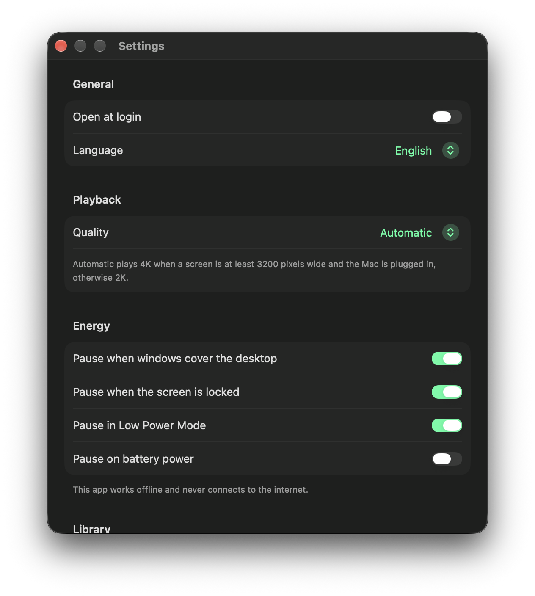

<p align="center"></p>

# Glowdrop

Free, open-source live wallpaper for macOS. Fully offline.

**English** · [ภาษาไทย](README.th.md)

Glowdrop plays a looping video as your desktop wallpaper, on every display, behind your desktop icons.
It lives in the menu bar, pauses itself when nobody can see the wallpaper, and never connects to the internet.


<p align="center"></p>

## Features

- **Any video you own**: MP4, MOV or M4V that macOS can play (H.264 or HEVC).
- **Offline only**: no network code, no account, no analytics. Your videos stay on your Mac.
- **Light on energy**: pauses when windows cover the desktop, the screen is locked, Low Power Mode is on,
  or (optional) the Mac runs on battery.
- **Picks the right size**: with `-4k` and `-2k` versions of a video, Auto quality plays 4K only on a wide
  display while plugged in, 2K otherwise.
- **Library with categories**: every subfolder of the library folder becomes a category in the gallery.
- **Easy to add**: drag a video onto the gallery, use "Add Video…", or right-click a video in Finder → Open With → Glowdrop.
- **Thai and English** interface.
- Three bundled glitch wallpapers (Neon Green, Neon Purple, RGB Glitch).

## Requirements

- macOS 13 Ventura or later
- Apple Silicon or Intel Mac

## Install

1. Download `Glowdrop-<version>.zip` from the [Releases page](https://github.com/nimbusNuii/glowdrop/releases). Don't use a copy someone
   re-sent you in a chat; the app is not signed by Apple, so a modified copy would look the same.
2. Check that the download is the original. In Terminal run

   ```sh
   shasum -a 256 ~/Downloads/Glowdrop-<version>.zip
   ```

   and compare the result with the SHA-256 on the Release page. If it differs, delete the file.
3. Unzip it and move `Glowdrop.app` to your Applications folder.
4. Open it. The first launch is blocked because the app is not notarized by Apple (it is a free project
   without a paid developer account):
   - **macOS 15 or later**: open System Settings → Privacy & Security, scroll down to the message about
     Glowdrop and click **Open Anyway**, then confirm.
   - **macOS 13–14**: Control-click (right-click) `Glowdrop.app` → **Open** → **Open**.

   You only need to do this once. Never turn off Gatekeeper for it.
5. The Glowdrop icon appears in the menu bar. Choose **Library…** to pick a wallpaper.

Rather not run a downloaded app? [Build it from source](#build-from-source) with `bash build.sh --install`.

Turn on **Open at login** in Settings (⌘,) if you want the wallpaper back after a restart.

## Add your own wallpapers

The quickest way is to drag a video onto the gallery window. To organise a collection, use the library
folder (Settings → Library, or the sidebar's "Open Library Folder"):

```
~/Library/Application Support/Glowdrop/Library/
├── Cozy/
│   ├── fireplace.mp4
│   ├── rainy-window-4k.mp4
│   ├── rainy-window-2k.mp4
│   ├── rainy-window-thumb.png
│   └── wallpapers.json
└── Space/
    └── nebula.mp4
```

- Each subfolder is a category.
- `<name>-4k`, `-2k`, `-2160p`, `-1440p` and `-1080p` files are versions of the same wallpaper; Glowdrop picks
  one for your display.
- `<name>-thumb.png` (or `.jpg`) is an optional thumbnail.
- An optional `wallpapers.json` sets titles, order and the default wallpaper for the videos in its own folder
  (names without the `-4k`/`-2k` part). For `Cozy/` above:

  ```json
  {
    "order": ["rainy-window", "fireplace"],
    "items": { "rainy-window": { "title": "Rainy Window", "default": true } }
  }
  ```

WebM and MKV files are not supported; convert them to MP4 first.
Only add videos you have the right to use.

## Build from source

Needs the Xcode Command Line Tools (`xcode-select --install`); no Xcode project.

```sh
bash build.sh             # build/Glowdrop.app for this Mac, runs the self-tests
bash build.sh --install   # also copies it to ~/Applications
bash build.sh --release   # universal app + dist/Glowdrop-<version>.zip
```

`--release` renders the bundled wallpapers first (a few minutes) into `Resources/Wallpapers` with
`tools/glitch-render`, a small CoreGraphics/Core Image renderer. They are rendered once; delete
`Resources/Wallpapers` to render them again. To use the renderer yourself, build it with
`bash tools/glitch-render/build.sh`, then run `tools/glitch-render/build/glitch-render --help` to see its
options (palette, logo text, HUD text, size, frame rate).

## Privacy

Glowdrop has no network code and collects no data. Settings are stored with macOS user defaults;
videos are read from folders you choose.

## License

[MIT](LICENSE). The bundled wallpapers are generated by the MIT-licensed renderer in `tools/glitch-render`.
