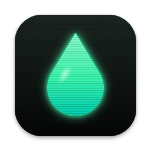
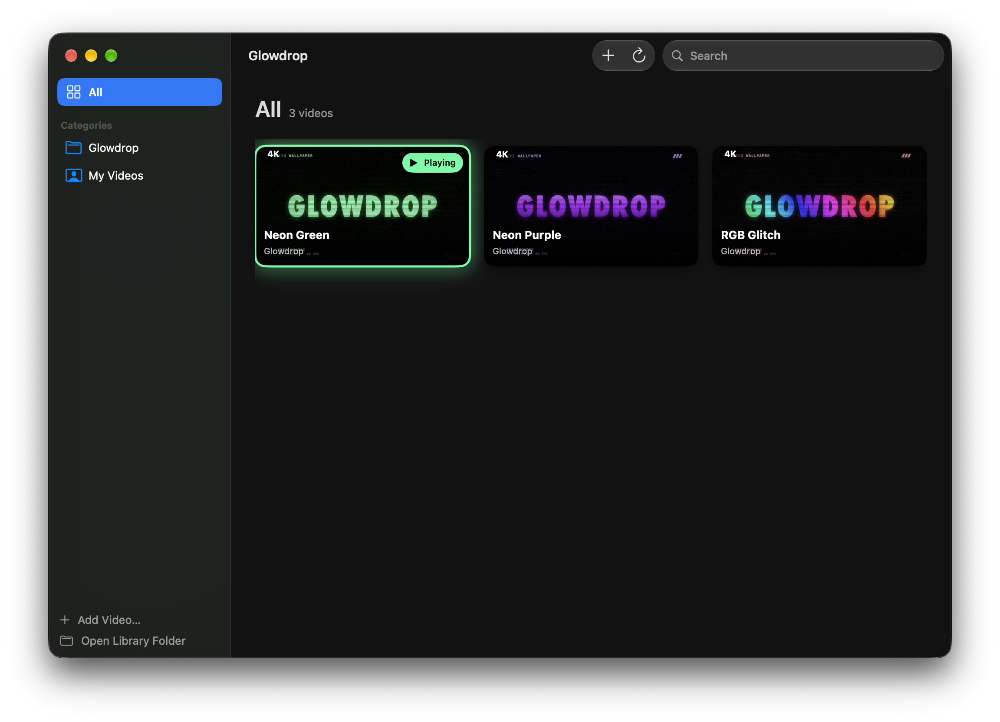

<p align="center"></p>

# Glowdrop

Free, open-source live wallpaper for macOS. Fully offline.

**English** · [ภาษาไทย](README.th.md)

Glowdrop plays a looping video as your desktop wallpaper, on every display, behind your desktop icons.
It lives in the menu bar, pauses itself when nobody can see the wallpaper, and never connects to the internet.



<p align="center"></p>

## Features

- **Any video you own**: MP4, MOV or M4V that macOS can play (H.264 or HEVC).
- **Offline only**: no network code, no account, no analytics. Your videos stay on your Mac.
- **Light on energy**: pauses when windows cover the desktop, the screen is locked, Low Power Mode is on,
  or (optional) the Mac runs on battery.
- **Respects Reduce Motion**: shows a still image while macOS's Reduce Motion is on (you can turn this off in
  Settings).
- **Picks the right size**: with `-4k` and `-2k` versions of a video, Auto quality plays 4K only on a wide
  display while plugged in, 2K otherwise.
- **Plays like Aerials (macOS 26+, experimental)**: macOS plays your videos on the desktop and the Lock Screen,
  even after you quit Glowdrop, with a tile per video in System Settings → Wallpaper.
- **Library with categories**: every subfolder of the library folder becomes a category in the gallery.
- **Easy to add**: drag a video onto the gallery, use "Add Video…", or right-click a video in Finder → Open With → Glowdrop.
- **Thai and English** interface.
- Three bundled glitch wallpapers (Neon Green, Neon Purple, RGB Glitch).

## Requirements

- macOS 13 Ventura or later
- Apple Silicon or Intel Mac

## Install

1. Download `Glowdrop-<version>.dmg` from the [Releases page](https://github.com/nimbusNuii/glowdrop/releases)
   (a `.zip` is there too). Don't use a copy someone re-sent you in a chat; the app is not signed by Apple, so a
   modified copy would look the same.
2. Check that the download is the original. In Terminal run

   ```sh
   shasum -a 256 ~/Downloads/Glowdrop-<version>.dmg
   ```

   and compare the result with the SHA-256 on the Release page. If it differs, delete the file.
3. Open the `.dmg` and drag **Glowdrop** onto the **Applications** folder in the window, then eject the disk image.
   (With the `.zip`: unzip it and move `Glowdrop.app` to Applications.)
4. Open it. The first launch is blocked because the app is not notarized by Apple (it is a free project
   without a paid developer account):
   - **macOS 15 or later**: open System Settings → Privacy & Security, scroll down to the message about
     Glowdrop and click **Open Anyway**, then confirm.
   - **macOS 13–14**: Control-click (right-click) `Glowdrop.app` → **Open** → **Open**.

   You only need to do this once. Never turn off Gatekeeper for it.
5. The Glowdrop icon appears in the menu bar. Choose **Library…** to pick a wallpaper.

Rather not run a downloaded app? [Build it from source](#build-from-source) with `bash build.sh --install`.

Turn on **Open at login** in Settings (⌘,) if you want the wallpaper back after a restart.

## Add your own wallpapers

The quickest way is to drag a video onto the gallery window. To organise a collection, use the library
folder (Settings → Library, or the sidebar's "Open Library Folder"):

```
~/Library/Application Support/Glowdrop/Library/
├── Cozy/
│   ├── fireplace.mp4
│   ├── rainy-window-4k.mp4
│   ├── rainy-window-2k.mp4
│   ├── rainy-window-thumb.png
│   └── wallpapers.json
└── Space/
    └── nebula.mp4
```

- Each subfolder is a category.
- `<name>-4k`, `-2k`, `-2160p`, `-1440p` and `-1080p` files are versions of the same wallpaper; Glowdrop picks
  one for your display.
- `<name>-thumb.png` (or `.jpg`) is an optional thumbnail.
- An optional `wallpapers.json` sets titles, order and the default wallpaper for the videos in its own folder
  (names without the `-4k`/`-2k` part). For `Cozy/` above:

  ```json
  {
    "order": ["rainy-window", "fireplace"],
    "items": { "rainy-window": { "title": "Rainy Window", "default": true } }
  }
  ```

WebM and MKV files are not supported; convert them to MP4 first.
Only add videos you have the right to use.

## macOS wallpaper engine (experimental, macOS 26+)

On macOS 26 or later Glowdrop can hand its videos to macOS, the way Apple's Aerials work:

- The video keeps playing on the desktop and the Lock Screen after you quit Glowdrop.
- Every wallpaper in the library gets its own tile in System Settings → Wallpaper, so each display or
  Space can show a different video.
- The **Glowdrop** tile follows whatever you pick in the Glowdrop app.
- Right-click any Glowdrop tile for **Add Video…** or **Open Glowdrop Library…**.

Turn it on:

1. Open Glowdrop at least once (after **Open Anyway**, see [Install](#install)).
2. Settings (⌘,) → Wallpaper engine → choose **macOS wallpaper**.
3. Click **Open Wallpaper Settings…** and choose **Glowdrop** (follows the app) or one of the Glowdrop
   videos for each display.

**Pause** in the menu bar, Low Power Mode, the battery rule and the Reduce Motion setting work with both engines.
"Pause when windows cover the desktop" works only with the Glowdrop window engine for now.

If a wallpaper gets stuck, grey or shows the wrong video, choose **Restart Wallpaper Agent** in the menu bar.
It does the same as `killall WallpaperAgent`; macOS starts the agent again by itself.

Prefer the old way? Choose **Glowdrop window**: Glowdrop draws the video behind your icons while the app runs,
and **Show on Lock Screen** puts the playing video on the Lock Screen too.

If the Glowdrop tiles do not appear in Wallpaper, you may run this command yourself; it tells macOS to trust
the wallpaper extension inside this copy of Glowdrop:
`/System/Library/Frameworks/CoreServices.framework/Frameworks/LaunchServices.framework/Support/lsregister -f -trusted /Applications/Glowdrop.app`.
To undo it, run the same command with `-u` in place of `-f -trusted`:
`/System/Library/Frameworks/CoreServices.framework/Frameworks/LaunchServices.framework/Support/lsregister -u /Applications/Glowdrop.app`.

To stop using it, first choose another wallpaper in System Settings → Wallpaper, then switch Glowdrop back to
**Glowdrop window**.

It uses undocumented macOS interfaces, so a macOS update may break it; the Glowdrop window engine keeps working.
Glowdrop puts copies of its videos (mp4, mov or m4v) in `~/Library/Application Support/Glowdrop/LockScreen/`,
the only folder the wallpaper extension can read. On the same drive they are instant APFS clones that use almost
no space. Videos on another drive get no tile of their own, because that would copy them in full; they still
play through the **Glowdrop** tile, which copies only the playing video. The same goes for library videos that
are links to files outside the library folder, and for "My Videos" files in Desktop, Documents, Downloads or
iCloud Drive: Glowdrop never copies those folders' files on its own. The copies can be read by other apps
running as you, unlike files inside protected folders such as Desktop or Documents.

## Build from source

Needs the Xcode Command Line Tools (`xcode-select --install`); no Xcode project.

```sh
bash build.sh             # build/Glowdrop.app for this Mac, runs the self-tests
bash build.sh --install   # also copies it to ~/Applications
bash build.sh --release   # universal app + dist/Glowdrop-<version>.dmg and .zip
```

`--release` renders the bundled wallpapers first (a few minutes) into `Resources/Wallpapers` with
`tools/glitch-render`, a small CoreGraphics/Core Image renderer. They are rendered once; delete
`Resources/Wallpapers` to render them again. To use the renderer yourself, build it with
`bash tools/glitch-render/build.sh`, then run `tools/glitch-render/build/glitch-render --help` to see its
options (palette, logo text, HUD text, size, frame rate).

## Privacy

Glowdrop has no network code and collects no data. Settings are stored with macOS user defaults;
videos are read from folders you choose.

## Credits

The wallpaper extension's plumbing (the wallpaper extension point, its XPC interface, the Settings tiles and the
video pipeline)
is derived from [Phosphene](https://github.com/kageroumado/phosphene), MIT License; see
[THIRD_PARTY_LICENSES/phosphene-LICENSE](THIRD_PARTY_LICENSES/phosphene-LICENSE).

## License

[MIT](LICENSE). The bundled wallpapers are generated by the MIT-licensed renderer in `tools/glitch-render`.
