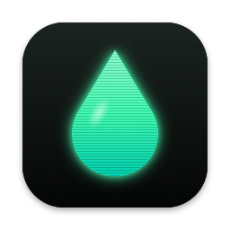
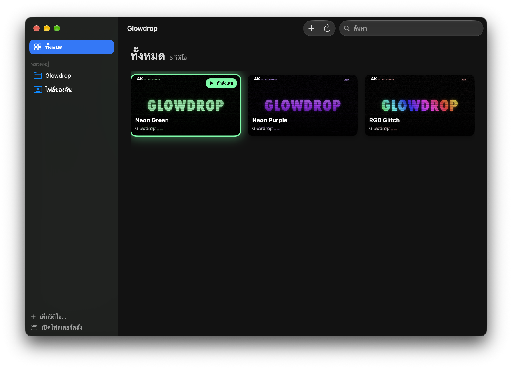
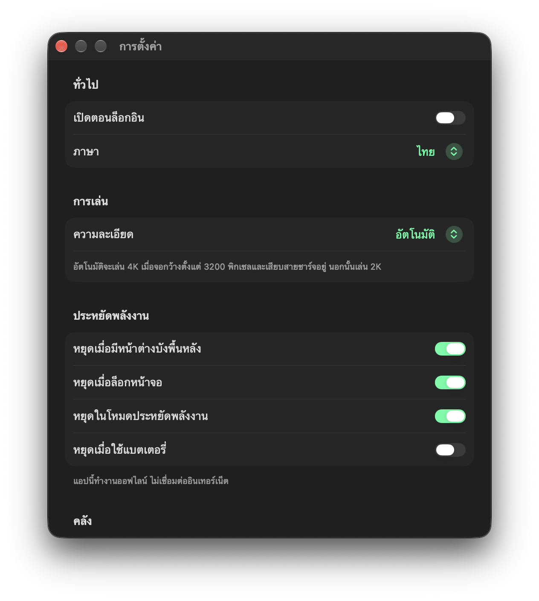

<p align="center"></p>

# Glowdrop

วอลเปเปอร์เคลื่อนไหวสำหรับ macOS ฟรี โอเพนซอร์ส และใช้งานแบบออฟไลน์ทั้งหมด

[English](README.md) · **ภาษาไทย**

Glowdrop เล่นวิดีโอวนซ้ำเป็นพื้นหลังเดสก์ท็อป ทุกจอ อยู่ใต้ไอคอนบนเดสก์ท็อป
แอปอยู่ที่แถบเมนูด้านบน หยุดเล่นเองเมื่อไม่มีใครเห็นพื้นหลัง และไม่เชื่อมต่ออินเทอร์เน็ตเลย



<p align="center"></p>

## ความสามารถ

- **ใช้วิดีโอของคุณเองได้**: ไฟล์ MP4, MOV หรือ M4V ที่ macOS เล่นได้ (H.264 หรือ HEVC)
- **ออฟไลน์อย่างเดียว**: ไม่มีโค้ดเชื่อมต่อเน็ต ไม่ต้องมีบัญชี ไม่เก็บข้อมูลการใช้งาน วิดีโออยู่ในเครื่องคุณเท่านั้น
- **ประหยัดพลังงาน**: หยุดเองเมื่อมีหน้าต่างบังพื้นหลัง ล็อกหน้าจอ เปิด Low Power Mode
  หรือ (เลือกได้) ตอนใช้แบตเตอรี่
- **เลือกความละเอียดให้เอง**: ถ้ามีวิดีโอทั้งไฟล์ `-4k` และ `-2k` โหมดอัตโนมัติจะเล่น 4K เฉพาะตอนจอกว้างและเสียบสายชาร์จ
  นอกนั้นเล่น 2K
- **เล่นแบบ Aerials (macOS 26 ขึ้นไป, ทดลอง)**: macOS เล่นวิดีโอให้ทั้งเดสก์ท็อปและหน้าล็อก ปิดแอปแล้วก็ยังเล่น
  และมีช่องของแต่ละวิดีโอใน System Settings → Wallpaper
- **คลังแบ่งหมวด**: โฟลเดอร์ย่อยแต่ละอันในโฟลเดอร์คลังจะเป็นหมวดหนึ่งในแกลเลอรี
- **เพิ่มวิดีโอง่าย**: ลากไฟล์มาวางในแกลเลอรี กดปุ่ม "เพิ่มวิดีโอ…" หรือคลิกขวาที่วิดีโอใน Finder → Open With → Glowdrop
- **มีภาษาไทยและอังกฤษ**
- มีวอลเปเปอร์ glitch ติดมาให้ 3 แบบ (Neon Green, Neon Purple, RGB Glitch)

## ความต้องการของระบบ

- macOS 13 Ventura ขึ้นไป
- Mac ชิป Apple Silicon หรือ Intel

## วิธีติดตั้ง

1. ดาวน์โหลด `Glowdrop-<เวอร์ชัน>.dmg` จาก[หน้า Releases](https://github.com/nimbusNuii/glowdrop/releases)เท่านั้น (มีแบบ `.zip` ด้วย)
   อย่าใช้ไฟล์ที่มีคนส่งต่อมาในแชต เพราะแอปไม่ได้เซ็นกับ Apple ไฟล์ที่ถูกแก้จะดูเหมือนของจริงทุกอย่าง
2. เช็คว่าไฟล์เป็นของแท้ เปิด Terminal แล้วรัน

   ```sh
   shasum -a 256 ~/Downloads/Glowdrop-<เวอร์ชัน>.dmg
   ```

   เทียบผลกับค่า SHA-256 ในหน้า Release ถ้าไม่ตรงกัน ให้ลบไฟล์ทิ้ง
3. ดับเบิลคลิกไฟล์ `.dmg` แล้วลากไอคอน **Glowdrop** ไปวางที่โฟลเดอร์ **Applications** ในหน้าต่างนั้น เสร็จแล้วกด Eject
   (ถ้าใช้ `.zip`: แตกไฟล์ แล้วย้าย `Glowdrop.app` ไปไว้ในโฟลเดอร์ Applications)
4. เปิดแอป ครั้งแรก macOS จะไม่ยอมให้เปิด เพราะแอปไม่ได้ผ่านการรับรอง (notarize) จาก Apple
   (เป็นโปรเจกต์ฟรีที่ไม่มีบัญชีนักพัฒนาแบบเสียเงิน) ให้ทำแบบนี้:
   - **macOS 15 ขึ้นไป**: เปิด System Settings → Privacy & Security เลื่อนลงไปหาข้อความเกี่ยวกับ Glowdrop
     กด **Open Anyway** แล้วยืนยัน
   - **macOS 13–14**: กด Control ค้างแล้วคลิก (หรือคลิกขวา) ที่ `Glowdrop.app` → **Open** → **Open**

   ทำครั้งเดียวพอ และห้ามปิด Gatekeeper ทั้งเครื่องเพื่อเปิดแอปนี้
5. ไอคอน Glowdrop จะขึ้นที่แถบเมนู กด **คลังวิดีโอ…** เพื่อเลือกวอลเปเปอร์

ไม่อยากรันแอปที่โหลดมา? [build เองจากซอร์สโค้ด](#build-จากซอร์สโค้ด) ด้วย `bash build.sh --install`

ถ้าอยากให้วอลเปเปอร์กลับมาเองหลังรีสตาร์ต ให้เปิด **เปิดตอนล็อกอิน** ใน Settings (⌘,)

แอปใช้ภาษาตาม macOS ถ้าเครื่องตั้งเป็นภาษาอังกฤษ เมนูจะเป็นภาษาอังกฤษ (คลังวิดีโอ… = Library…,
เปิดตอนล็อกอิน = Open at login) เปลี่ยนเป็นภาษาไทยได้ที่ Settings → Language

## เพิ่มวอลเปเปอร์ของคุณเอง

วิธีที่เร็วที่สุดคือลากวิดีโอมาวางในหน้าต่างแกลเลอรี ถ้าอยากจัดเป็นหมวด ให้ใช้โฟลเดอร์คลัง
(Settings → คลัง หรือปุ่ม "เปิดโฟลเดอร์คลัง" ที่แถบด้านซ้าย):

```
~/Library/Application Support/Glowdrop/Library/
├── Cozy/
│   ├── fireplace.mp4
│   ├── rainy-window-4k.mp4
│   ├── rainy-window-2k.mp4
│   ├── rainy-window-thumb.png
│   └── wallpapers.json
└── Space/
    └── nebula.mp4
```

- โฟลเดอร์ย่อยแต่ละอันคือหนึ่งหมวด
- ไฟล์ชื่อ `<ชื่อ>-4k`, `-2k`, `-2160p`, `-1440p` และ `-1080p` คือวอลเปเปอร์ตัวเดียวกันคนละความละเอียด
  Glowdrop จะเลือกให้เหมาะกับจอ
- `<ชื่อ>-thumb.png` (หรือ `.jpg`) คือภาพตัวอย่าง ใส่หรือไม่ใส่ก็ได้
- ใส่ไฟล์ `wallpapers.json` เพื่อตั้งชื่อ ลำดับ และวอลเปเปอร์เริ่มต้นของวิดีโอในโฟลเดอร์เดียวกันได้ (ไม่บังคับ)
  ใช้ชื่อไฟล์ที่ตัด `-4k`/`-2k` ออก ตัวอย่างสำหรับโฟลเดอร์ `Cozy/` ข้างบน:

  ```json
  {
    "order": ["rainy-window", "fireplace"],
    "items": { "rainy-window": { "title": "หน้าต่างฝนตก", "default": true } }
  }
  ```

ยังไม่รองรับไฟล์ WebM และ MKV ให้แปลงเป็น MP4 ก่อน
ใส่เฉพาะวิดีโอที่คุณมีสิทธิ์ใช้งาน

## ให้ macOS เล่นวอลเปเปอร์ (ทดลอง, macOS 26 ขึ้นไป)

บน macOS 26 ขึ้นไป Glowdrop ส่งวิดีโอให้ macOS เล่นเองได้ แบบเดียวกับวอลเปเปอร์ Aerials ของ Apple:

- ปิด Glowdrop แล้ววิดีโอยังเล่นต่อทั้งบนเดสก์ท็อปและหน้าล็อก
- วอลเปเปอร์ทุกอันในคลังมีช่องของตัวเองใน System Settings → Wallpaper แต่ละจอหรือแต่ละ Space
  จึงใช้วิดีโอต่างกันได้
- ช่อง **Glowdrop** จะเล่นตามวิดีโอที่เลือกในแอป Glowdrop

วิธีเปิด:

1. เปิด Glowdrop อย่างน้อยหนึ่งครั้ง (หลังกด **Open Anyway** ตามขั้นตอนติดตั้งด้านบน)
2. Settings (⌘,) → ตัวเล่นวอลเปเปอร์ → เลือก **วอลเปเปอร์ของ macOS**
3. กด **เปิดการตั้งค่าวอลเปเปอร์…** แล้วเลือก **Glowdrop** (เล่นตามแอป) หรือวิดีโอของ Glowdrop สำหรับแต่ละจอ

**หยุดชั่วคราว** ในแถบเมนู, Low Power Mode และกฎตอนใช้แบตเตอรี่ใช้ได้กับทั้งสองแบบ ส่วน "หยุดเมื่อมีหน้าต่างบังพื้นหลัง"
ตอนนี้ใช้ได้เฉพาะแบบหน้าต่างของ Glowdrop

ถ้าวอลเปเปอร์ค้าง เป็นสีเทา หรือเล่นผิดวิดีโอ ให้เลือก **รีสตาร์ต Wallpaper Agent** ในแถบเมนู
(เหมือนรัน `killall WallpaperAgent` แล้ว macOS จะเปิด agent ใหม่เอง)

อยากใช้แบบเดิม? เลือก **หน้าต่างของ Glowdrop**: Glowdrop วาดวิดีโอไว้หลังไอคอนบนเดสก์ท็อปตอนแอปเปิดอยู่
และตัวเลือก **แสดงบนหน้าล็อก** จะเอาวิดีโอที่เล่นอยู่ไปแสดงบนหน้าล็อกด้วย

ถ้าไม่เห็นช่องของ Glowdrop ใน Wallpaper คุณรันคำสั่งนี้เองได้ คำสั่งนี้บอก macOS ให้เชื่อถือส่วนเสริมวอลเปเปอร์ที่อยู่ใน
Glowdrop ชุดนี้:
`/System/Library/Frameworks/CoreServices.framework/Frameworks/LaunchServices.framework/Support/lsregister -f -trusted /Applications/Glowdrop.app`
ถ้าจะยกเลิก ให้รันคำสั่งเดิมโดยใช้ `-u` แทน `-f -trusted`:
`/System/Library/Frameworks/CoreServices.framework/Frameworks/LaunchServices.framework/Support/lsregister -u /Applications/Glowdrop.app`

ถ้าจะเลิกใช้ ให้เลือกวอลเปเปอร์อื่นใน System Settings → Wallpaper ก่อน แล้วค่อยเปลี่ยน Glowdrop กลับเป็น **หน้าต่างของ Glowdrop**

ฟีเจอร์นี้ใช้ส่วนของ macOS ที่ Apple ไม่ได้เปิดเผยเป็นทางการ จึงอาจหยุดทำงานหลังอัปเดต macOS แต่แบบหน้าต่างของ Glowdrop
ยังใช้ได้ตามปกติ Glowdrop จะสำเนาวิดีโอ (mp4, mov หรือ m4v) ไว้ที่ `~/Library/Application Support/Glowdrop/LockScreen/`
ซึ่งเป็นโฟลเดอร์เดียวที่ส่วนเสริมวอลเปเปอร์อ่านได้ ถ้าอยู่ไดรฟ์เดียวกันจะเป็นการ clone บน APFS ทันทีและแทบไม่ใช้พื้นที่
วิดีโอที่อยู่คนละไดรฟ์จะไม่มีช่องของตัวเอง เพราะต้องคัดลอกทั้งไฟล์ แต่ยังเล่นผ่านช่อง **Glowdrop** ได้
ซึ่งจะคัดลอกเฉพาะวิดีโอที่เล่นอยู่ เช่นเดียวกับวิดีโอในคลังที่เป็นลิงก์ไปยังไฟล์นอกโฟลเดอร์คลัง
และไฟล์ใน "ไฟล์ของฉัน" ที่อยู่ใน Desktop, Documents, Downloads หรือ iCloud Drive: Glowdrop จะไม่คัดลอกไฟล์จากโฟลเดอร์เหล่านี้เอง
ไฟล์ที่สำเนาไว้นี้แอปอื่นที่รันในชื่อผู้ใช้ของคุณอ่านได้
ต่างจากไฟล์ในโฟลเดอร์ที่ macOS ป้องกันไว้ เช่น Desktop หรือ Documents

## Build จากซอร์สโค้ด

ต้องมี Xcode Command Line Tools (`xcode-select --install`) ไม่ต้องใช้โปรเจกต์ Xcode

```sh
bash build.sh             # สร้าง build/Glowdrop.app สำหรับเครื่องนี้ และรันชุดทดสอบ
bash build.sh --install   # สร้างแล้วคัดลอกไปไว้ที่ ~/Applications
bash build.sh --release   # แอป universal + dist/Glowdrop-<เวอร์ชัน>.dmg และ .zip
```

`--release` จะเรนเดอร์วอลเปเปอร์ที่ติดมากับแอปก่อน (ใช้เวลาไม่กี่นาที) ลงใน `Resources/Wallpapers` ด้วย
`tools/glitch-render` ซึ่งเป็นตัวเรนเดอร์ขนาดเล็กที่ใช้ CoreGraphics/Core Image เรนเดอร์ครั้งเดียวแล้วใช้ซ้ำ
ถ้าอยากเรนเดอร์ใหม่ให้ลบโฟลเดอร์ `Resources/Wallpapers` ถ้าจะใช้ตัวเรนเดอร์เอง ให้ build ก่อนด้วย
`bash tools/glitch-render/build.sh` แล้วรัน `tools/glitch-render/build/glitch-render --help` เพื่อดูตัวเลือก
(สี ข้อความโลโก้ ข้อความ HUD ขนาด เฟรมเรต)

## ความเป็นส่วนตัว

Glowdrop ไม่มีโค้ดเชื่อมต่อเครือข่ายและไม่เก็บข้อมูลใดๆ การตั้งค่าเก็บไว้ใน user defaults ของ macOS
วิดีโออ่านจากโฟลเดอร์ที่คุณเลือกเท่านั้น

## เครดิต

ส่วนเชื่อมต่อของส่วนเสริมวอลเปเปอร์ (extension point ของวอลเปเปอร์ อินเทอร์เฟซ XPC ช่องใน Settings และส่วนเล่นวิดีโอ)
ดัดแปลงมาจาก [Phosphene](https://github.com/kageroumado/phosphene) ซึ่งใช้สัญญาอนุญาต MIT
ดู [THIRD_PARTY_LICENSES/phosphene-LICENSE](THIRD_PARTY_LICENSES/phosphene-LICENSE)

## สัญญาอนุญาต

[MIT](LICENSE) วอลเปเปอร์ที่ติดมากับแอปสร้างจากตัวเรนเดอร์ใน `tools/glitch-render` ซึ่งใช้สัญญาอนุญาต MIT เช่นกัน
